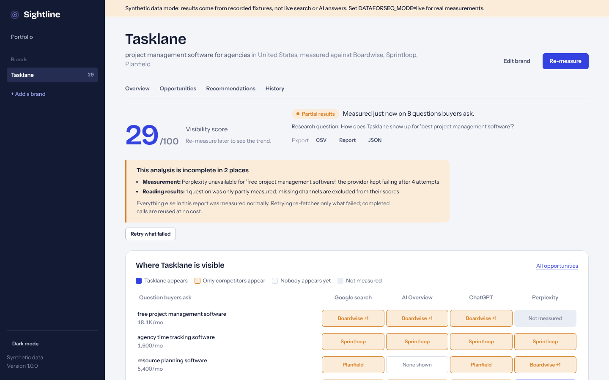
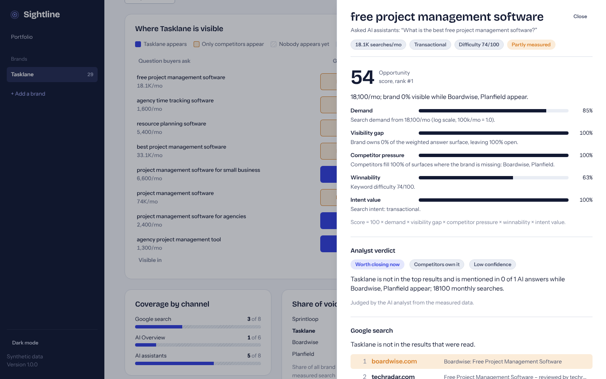
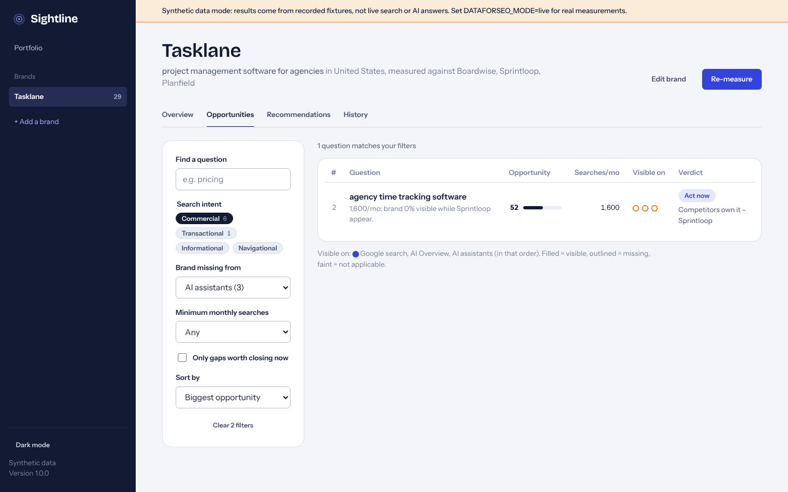
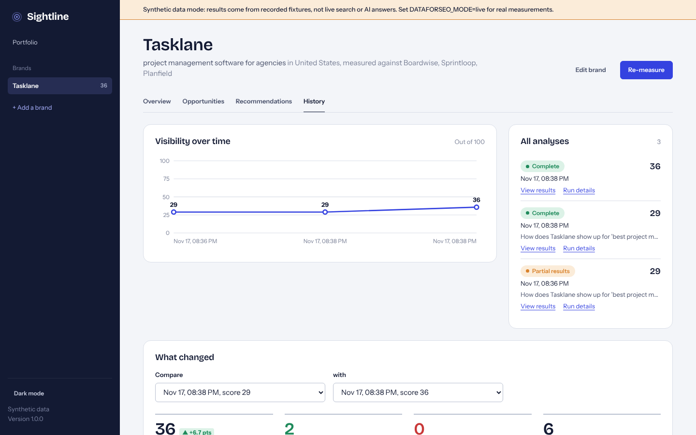
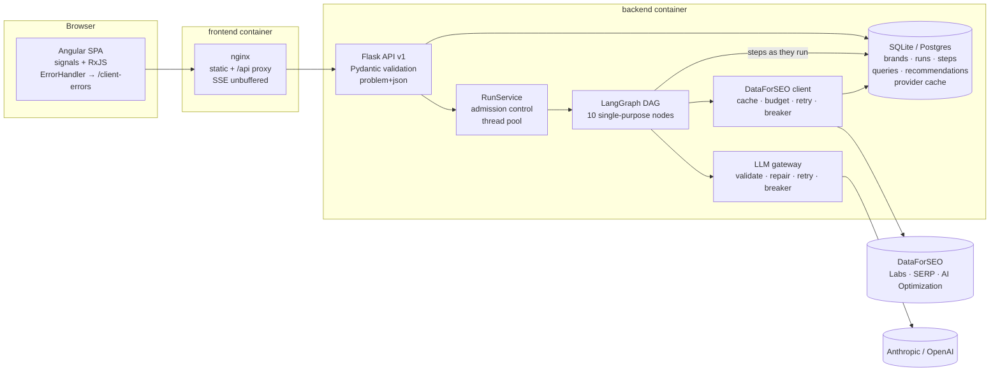
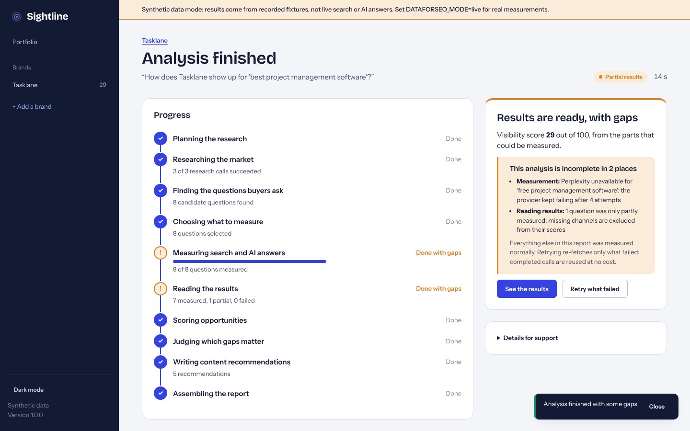

# Sightline: AI Visibility Platform

Sightline shows a marketer where their brand appears in **Google search**, **Google AI Overviews** and **AI assistants** (ChatGPT, Perplexity, and optionally Gemini or Claude). It also shows where competitors appear instead, which of those gaps are worth closing, and what content to publish to close them. A marketer can re-measure later and see what changed.

- **Backend:** Python 3.12, Flask, LangGraph multi-agent DAG, DataForSEO (live data), Anthropic or OpenAI for the AI stages, SQLAlchemy, structlog, Prometheus.
- **Frontend:** Angular 22 (standalone components, strict TypeScript, signals and RxJS, Reactive Forms, lazy routes), with its own design system and no component library.
- **Run it:** `make run` (Docker Compose), then open **http://localhost:8080**.

**Walkthrough video (4 min):** [docs/walkthrough.mp4](docs/walkthrough.mp4)



---

## Contents

1. [Quick start](#1-quick-start)
2. [What a user can do](#2-what-a-user-can-do)
3. [Architecture and why](#3-architecture-and-why)
4. [The AI pipeline (DAG)](#4-the-ai-pipeline-dag)
5. [Tool calling and DataForSEO](#5-tool-calling-and-dataforseo)
6. [How opportunity is scored, and why](#6-how-opportunity-is-scored-and-why)
7. [Failure handling](#7-failure-handling)
8. [Slow work, history and cost](#8-slow-work-history-and-cost)
9. [API](#9-api)
10. [Observability and incident runbook](#10-observability-and-incident-runbook)
11. [Frontend](#11-frontend)
12. [Security](#12-security)
13. [Tests](#13-tests)
14. [Trade-offs](#14-trade-offs)
15. [Known limitations and what I would do next](#15-known-limitations-and-what-i-would-do-next)
16. [AI tools used](#16-ai-tools-used)
17. [Project layout](#17-project-layout)

---

## 1. Quick start

### Requirements

- Docker with Compose v2.24 or newer.
- A **DataForSEO** API login and password (https://app.dataforseo.com/api-access).
- An **Anthropic** *or* **OpenAI** API key.

### Run (one command, live data)

```bash
git clone <this repo> sightline && cd sightline
make run            # first run creates .env from backend/.env.example and asks you to fill it in
# edit .env: DATAFORSEO_LOGIN, DATAFORSEO_PASSWORD, LLM_PROVIDER + ANTHROPIC_API_KEY (or OPENAI_API_KEY)
make run            # builds both images and starts them
```

| URL | What |
|---|---|
| http://localhost:8080 | The app (nginx serves the Angular build and proxies `/api` to Flask) |
| http://localhost:8000/api/docs | Interactive API documentation (OpenAPI 3.1, Swagger UI) |
| http://localhost:8000/metrics | Prometheus metrics |
| http://localhost:8000/health/ready | Readiness check (database, configuration, circuit breakers) |

Without Make: `cp backend/.env.example .env`, fill it in, then run `docker compose up --build`.

**End-to-end check on a clean machine:** add a brand (for example your own site and two competitors), click **Run first analysis**, and watch the progress page. A live run with the defaults (8 questions × Google SERP + 2 AI assistants) takes about 1–3 minutes and costs about **$0.30–0.60** in DataForSEO credit. The cost is capped by `MAX_COST_PER_RUN_USD`.

### Offline demo mode (no keys)

```bash
make demo   # DATAFORSEO_MODE=fixtures LLM_PROVIDER=fixtures
```

Demo mode replays **synthetic** DataForSEO responses for a fictional brand ("Tasklane" and its competitors) and uses a deterministic offline model. It exists for automated tests and offline demos only. It is never the default: the API reports it (`GET /api/v1/meta` → `synthetic_data: true`) and the UI shows a permanent banner. The fixtures use the real DataForSEO response envelope, so the full client stack (classification, retries, breaker, cache, parsing) runs as it does in production. They also inject faults (a 429, an HTTP 500 and a Perplexity outage), so the demo shows retries and a partial run.

### Local development without Docker

```bash
make dev     # backend on :8000 (venv + gunicorn), frontend on :4200 (ng serve with a proxy to :8000)
make test    # ruff + mypy --strict + pytest, and the Angular unit tests + production build
```

### Configuration

Every setting comes from the environment. All of them are documented in **[`backend/.env.example`](backend/.env.example)** (backend) and **[`frontend/.env.example`](frontend/.env.example)** (frontend runtime config, written to `/config.json` when the container starts, so one build runs everywhere). The important ones:

| Variable | Default | Purpose |
|---|---|---|
| `DATAFORSEO_LOGIN` / `DATAFORSEO_PASSWORD` | – | Required for live data |
| `LLM_PROVIDER` | `anthropic` | `anthropic` or `openai` (`fixtures` is for tests and the demo only) |
| `ANTHROPIC_API_KEY` / `OPENAI_API_KEY` | – | Key for the chosen provider |
| `LLM_MODEL` | provider default | Overrides the model (`claude-sonnet-5-5` / `gpt-4.1` by default) |
| `AI_ENGINES` | `chat_gpt:gpt-4.1-mini,perplexity:sonar` | AI assistants measured through DataForSEO (`gemini:…` and `claude:…` are also supported) |
| `MAX_QUERIES_PER_RUN` | 8 | Questions measured per run |
| `MAX_COST_PER_RUN_USD` | 1.50 | Hard ceiling on DataForSEO spend per run |
| `RETRY_MAX_ATTEMPTS`, `RETRY_BASE_DELAY_S`, `RETRY_MAX_DELAY_S` | 4, 0.5, 8 | Retry policy |
| `CIRCUIT_FAILURE_THRESHOLD`, `CIRCUIT_RESET_TIMEOUT_S` | 5, 30 | Circuit breaker |
| `DATAFORSEO_*_TIMEOUT_S` | 5 / 45 / 125 | Connect / read / AI-answer read timeouts |

If credentials are missing, the service still starts and serves history. `/health/ready` returns 503 and lists what is missing, the UI shows a banner, and `POST /runs` returns `503` with an explanation instead of failing halfway through a run.

---

## 2. What a user can do

| Need (from the brief) | Where |
|---|---|
| 1. Set up a brand and its competitors | **Add a brand**: Reactive Form with domain normalisation, duplicate and self-competitor checks, market location and language, optional seed topics. Server validation errors map back onto the exact field. |
| 2. Start an analysis, follow it, understand partial results | **Re-measure / Run first analysis** → the run page shows ten plain-language stages that update live (server-sent events, with polling as a fallback). A finished run shows *Complete*, *Results ready, with gaps* (listing exactly what is missing, with a **Retry what failed** button) or *No results*. |
| 3. See at a glance where the brand is and is not visible | Brand **Overview**: the *visibility map* (every question × Google / AI Overview / each AI assistant, coloured by who owns it), visibility score with trend, coverage by channel, share of voice, AI-written insights. |
| 4. Explore and narrow opportunities | **Opportunities**: server-side filters (search, intent, "brand missing from…", minimum volume, "worth closing only", sort). Filters live in the URL, so a view can be shared. Clicking a row opens the evidence drawer: score factors, analyst verdict, the actual top 10 results, AI Overview citations, the AI answers with brand and competitor names highlighted, and the question's history across runs. |
| 5. Act on recommendations | **Recommendations**: prioritised briefs (title, format, outline, must-cover points, sites to earn mentions on). Mark them *Start*, *Done* or *Dismiss*, and copy or download a brief as Markdown. |
| 6. Re-check and see what changed | **History**: visibility trend chart and a comparison of any two runs (questions improved, declined, held, new, or dropped, with before → after position, AI mentions and visibility). |
| 7. Overview across every brand | **Portfolio**: every brand with score, change, trend, biggest opportunity, open recommendations and run status. |
| Bonus | Background processing with live progress, dark mode, CSV / JSON / Markdown export, CI pipeline, and a recorded walkthrough (`docs/walkthrough.mp4`). |

| Evidence for one question | Opportunities | History and comparison |
|---|---|---|
|  |  |  |

Every screen has designed loading, empty, error and partial states. Errors are explained in plain language and include a reference id (the request id) that matches the server logs.

---

## 3. Architecture and why



**Decisions and reasons:**

- **One backend process, analysis on an in-process thread pool.** A run is 20–40 slow I/O calls, so threads are the right tool and there is nothing to deploy beyond one container. Run state lives in the database, not in memory, so any request thread (and the SSE stream) can read progress. Runs left unfinished by a restart are marked `failed / interrupted` at start-up instead of showing "running" forever. *Trade-off:* this does not scale horizontally (see §15).
- **The DAG is rebuilt per run with its dependencies injected.** Nodes are plain functions `(state, deps) → NodeResult`. Per-run objects (cost budget, metrics, recorder) cannot leak between runs, and every node can be unit-tested with fakes.
- **Process-wide singletons for what must be shared:** circuit breakers (a breaker that resets for every run protects nothing), the response cache and the HTTP connection pool. They are built once in `app/container.py`, the composition root.
- **SQLite by default, Postgres-ready.** SQLite in WAL mode keeps the clean-machine setup to one container. `DATABASE_URL` accepts any SQLAlchemy URL, and the model uses only portable types.
- **The API is the contract.** The frontend only calls documented endpoints. Typed TypeScript models mirror the Pydantic response models, and the OpenAPI document is generated from the same decorators that validate requests, so they cannot drift.

---

## 4. The AI pipeline (DAG)

```mermaid
flowchart TD
  S((start)) --> DP[discovery_planner<br/><i>LLM · plans keyword research tool calls</i>]
  DP --> DR[discovery_retriever<br/><i>executes DataForSEO Labs / Keywords calls</i>]
  DR --> DN[discovery_normalizer<br/><i>payloads → KeywordCandidate</i>]
  DN -->|candidates| MP
  DN -->|none found| SF[seed_fallback<br/><i>profile topics, volume unknown</i>]
  SF --> MP[measurement_planner<br/><i>LLM · picks questions, phrases buyer prompts, plans SERP + AI-answer calls</i>]
  MP -->|"Send() × N (parallel, one branch per question)"| MR[measurement_retriever<br/><i>SERP + each AI assistant for one question</i>]
  MP -->|no targets| RP
  MR --> MN[measurement_normalizer<br/><i>fan-in · payloads → QueryMeasurement</i>]
  MN --> SC[scorer<br/><i>deterministic opportunity score</i>]
  SC -->|measurable| GA[gap_analyst<br/><i>LLM · which gaps are worth closing (rule fallback)</i>]
  SC -->|nothing measurable| RP
  GA -->|gaps worth closing| RC[recommender<br/><i>LLM · content to publish (rule fallback)</i>]
  GA -->|none| RP
  RC --> RP[reporter<br/><i>JSON + Markdown report · always runs</i>]
  RP --> E((end))
```

The graph is **non-linear**. It has conditional routing at four points, a fallback node, and a parallel fan-out/fan-in (LangGraph `Send`, with the fan-in through a reducer on `measurement_results`). Every route ends at the `reporter`, so the user always gets a report, even if it says "nothing could be measured, and here is why".

### Agent responsibilities

Each node has exactly one job. **No node both fetches and reasons.** Each node also declares the state keys it reads and writes (`app/pipeline/graph.py::NODES`), and the instrumentation wrapper enforces the write set at run time.

| Node | Role (brief's naming) | Sole responsibility | Reads → writes | LLM? |
|---|---|---|---|---|
| `discovery_planner` | Query Planner | Decide which keyword-research calls reveal the questions buyers ask (seeds, tools, limits) | `brand` → `discovery_plan` | ✔ tool calling |
| `discovery_retriever` | Search / Retrieval | Execute the approved Labs / Keywords calls | `discovery_plan` → `discovery_results` | – |
| `discovery_normalizer` | Extraction / Normalization | Parse the three payload shapes, merge duplicates, filter, rank | `discovery_results` → `candidates` | – |
| `seed_fallback` | Fallback | If discovery found nothing, measure the profile's own topics (volume flagged *unknown*) | `brand` → `candidates` | – |
| `measurement_planner` | Query Planner | Choose which candidates to measure, write the buyer question for AI assistants, plan SERP and AI-answer calls | `candidates` → `measurement_targets` | ✔ tool calling |
| `measurement_retriever` (×N) | Search / Retrieval | Execute SERP and AI-answer calls for one question | `target` → `measurement_results` | – |
| `measurement_normalizer` | Extraction / Normalization | Turn SERP and AI-answer payloads into per-channel visibility (positions, citations, mentions) | `measurement_results` → `measurements` | – |
| `scorer` | (Analysis, deterministic) | Opportunity score with factor breakdown | `measurements` → `scored` | – |
| `gap_analyst` | Analysis / Synthesis | Judge which gaps are worth closing and why, plus headline insights | `scored` → `analysis` | ✔ structured |
| `recommender` | Analysis / Synthesis | Specific content to publish for the gaps worth closing | `analysis`, `scored` → `recommendations` | ✔ structured |
| `reporter` | Report | Assemble the final JSON report + human-readable Markdown | everything → `report` | – |

The stage contracts are frozen Pydantic models in `app/pipeline/contracts.py`. A stage that fails leaves the outputs of the others intact: the wrapper (`app/pipeline/nodes/base.py`) catches any exception, records a failed step and a *degradation*, and returns an empty update. Routing functions see the missing output and take the fallback path.

### Making the LLM stages reliable

- **Output is untrusted.** Structured answers come from a *forced* tool call whose schema is the expected Pydantic model. They are then re-validated, and also checked *semantically* (only ids we sent, no duplicates, every gap covered).
- **One targeted repair turn.** If validation fails, the model receives the exact validation errors and one chance to fix them (`LLM_REPAIR_ATTEMPTS`). If it fails again, the node falls back to rules and the run is marked partial. Malformed output never crashes a run and never reaches the user unchecked.
- **Sanitisation after validation.** Competitor names are filtered to the known list, and "sites to earn mentions on" are filtered to domains that were actually observed as cited (and are not the brand's or a competitor's own site).
- **The LLM never sets the score.** It judges and writes. The ranking stays reproducible from data.
- **Specific, robust prompts** (`app/pipeline/prompts.py`). Each system prompt states the task, the rules and what to do when data is thin. The user turn carries only data inside `<data>` tags, which is declared untrusted (brand descriptions and AI answers may contain instructions). Agents receive *normalised* data only, never raw provider payloads, which keeps prompts small and removes most of the prompt-injection surface.
- **The model never chooses trusted context.** Location, language and model names are injected by code, not chosen by the LLM.

---

## 5. Tool calling and DataForSEO

**One tool per logical API call** (`app/providers/dataforseo/tools.py`). Each tool is a Pydantic argument model (its JSON schema is what the LLM sees, with types, descriptions, bounds and `extra="forbid"`) plus a payload builder:

| Tool | DataForSEO endpoint | Used for |
|---|---|---|
| `keyword_suggestions` | `POST /v3/dataforseo_labs/google/keyword_suggestions/live` | Real queries containing a seed, with volume, competition, CPC, difficulty, intent |
| `related_keywords` | `POST /v3/dataforseo_labs/google/related_keywords/live` | Adjacent questions from Google's related searches |
| `search_volume` | `POST /v3/keywords_data/google_ads/search_volume/live` | Volume for explicit phrases (research question, seed topics) |
| `google_serp` | `POST /v3/serp/google/organic/live/advanced` with `load_async_ai_overview: true` | Organic positions, AI Overview presence and cited references, People-also-ask |
| `chat_gpt_answer`, `perplexity_answer` (+ `gemini_answer`, `claude_answer`) | `POST /v3/ai_optimization/{engine}/llm_responses/live` (web search on) | What each assistant answers to the buyer question, who it names and cites |

**Flow for every call:** the LLM proposes tool calls → `validate_tool_call` checks the schema (missing fields, ranges, bad JSON strings, unknown tools and extra arguments are all rejected with field-level reasons) → a semantic check runs (seeds must not be the brand's own name; `query_ref` must be one of the candidate ids; prompts must not mention the brand; the SERP keyword must equal the candidate) → rejected calls go back to the model once, with the reasons → **only validated calls are executed** → arguments are validated *again* right before execution (the plan may come from the LLM, a repair or a fallback rule). The measurement plan is then *completed by rule*, so every chosen question gets exactly one SERP call and one call per configured assistant.

**Data mode used:** **live** DataForSEO is the default and the only mode for real use. Synthetic fixtures (`DATAFORSEO_MODE=fixtures`) are used by the automated tests and the offline demo, behind a clearly marked flag and a UI banner.

**Two-level status handling.** DataForSEO returns HTTP 200 with a `status_code` at both the response and the task level. The client reads both: `20000` means OK; `40102` ("no search results") is a valid empty answer, not an error; `40106` means partial pages. Everything else is classified (see §7).

---

## 6. How opportunity is scored, and why

**Definition.** An opportunity is *demand the brand is not capturing, that competitors are capturing, that is realistically winnable, and that is commercially meaningful*:

```
opportunity = 100 × demand × gap × urgency × winnability × intent_value      (each factor ∈ [0, 1])
```

| Factor | Formula | Why |
|---|---|---|
| **demand** | `log10(1+volume) / log10(1+100 000)`, capped at 1. Unknown volume = 0.25 (flagged). | Log scale: the 10th thousand searches matter less than the first. An **absolute** scale (not relative to the run) keeps scores comparable across runs and brands. |
| **gap** | `1 − visibility` | What is left to win. |
| visibility | Channel-weighted: organic 0.40 (position on a CTR curve: #1 = 1.0, #2 = .55, #3 = .38 … #10 = .07, below that .03), AI Overview 0.25 (cited 1.0, mentioned .6), AI assistants 0.35 (named and cited 1.0, named .8, cited .5; averaged over assistants) | Mirrors where attention goes. **Channels that do not exist or failed are excluded and the weights renormalise.** No AI Overview on a SERP is not a miss, and a failed Perplexity call does not punish the brand. |
| **urgency** | `0.6 + 0.4 × competitor_pressure`, where pressure is the share of measured surfaces where a tracked competitor appears and the brand does not | A gap a competitor fills is losing share now. A gap nobody fills is still worth 60 % of that. |
| **winnability** | `1 − 0.5 × keyword_difficulty/100`. Unknown = 0.75. | Hard keywords are discounted but never zeroed: AI answers can still be won through third-party citations. |
| **intent_value** | commercial / transactional 1.0, informational 0.7, navigational 0.3 | A brand gains little from someone else's navigational query. |

**Why multiplicative:** any factor at zero makes the opportunity zero (a fully visible brand has nothing to gain). Each factor can be read on its own, and the product stays in [0, 100] without tuning. The UI shows every factor with a sentence of explanation ("Why it ranks #1"), and the tests check that the score equals the product of its displayed factors. **The LLM does not touch the ranking.** It adds a *verdict* (worth closing now or not) beside the score, with a reason grounded in the same data.

The brand-level **visibility score** (0–100) is the demand-weighted mean of query visibility, so high-volume questions count more.

---

## 7. Failure handling

### Retry, classification, breaker

`app/core/resilience.py` (retry with exponential backoff and **full jitter**, plus a three-state circuit breaker), `app/providers/dataforseo/client.py` and `app/providers/llm/gateway.py` (classification).

| Failure | Classified as | Behaviour |
|---|---|---|
| Timeout, connection error, HTTP 5xx / 408, non-JSON or envelope-less body ("junk"), DataForSEO 40101 / 40103 / 40107 / 50000 / 50301 / 50303 / 50401 … | `TransientError` | Retried: `RETRY_MAX_ATTEMPTS` attempts, delay `U(0, min(8 s, 0.5 s·2ⁿ))` |
| HTTP 429, DataForSEO 40202 (per-minute) / 40209 (concurrency) | `RateLimitedError` (transient) | Retried; `Retry-After` honoured within the cap |
| HTTP 401, DataForSEO 40100 / 40104 / 40207 | `AuthError` | **Not retried.** Fails fast; the readiness check shows the problem |
| HTTP 402, DataForSEO 40200 / 40210 / 40203 | `QuotaError` | Not retried |
| HTTP 400 / 404, DataForSEO 40501–40506 … | `PermanentError` | Not retried (our request is wrong) |
| Breaker open | `CircuitOpenError` | Fails fast, no network call, not retried |
| Run cost ceiling would be exceeded | `BudgetExceededError` | The call is not made; flagged as a degradation |

- **Timeouts on every external call:** connect 5 s; read 45 s for SERP and Labs, 125 s for AI-answer endpoints (DataForSEO runs those live tasks for up to 120 s); LLM 60 s. SDK-level retries are disabled (`max_retries=0`), so there is exactly one retry policy.
- **Circuit breakers** exist per DataForSEO endpoint family (`dataforseo:serp.google_organic`, `dataforseo:ai.perplexity`, …) and one for the LLM. They open after 5 consecutive *retryable* failures, stay open for 30 s, then let one trial call through. A Perplexity outage does not block SERP calls, and our own bad requests (4xx) never trip a breaker. Breaker state appears in `/health/ready` and in the `circuit_breaker_open` metric.

### Graceful degradation: what the user gets when a run only partly works

After retries are exhausted, a failed tool call becomes a failed `ToolResult`, never an exception. The question's other channels are still measured, the failed channel is marked `failed` and **excluded** from that question's score (weights renormalise), and the run finishes as **`partial`** with a list of *degradations* in plain language:

| What failed | Fallback | Run status |
|---|---|---|
| One AI assistant or the SERP for some questions | Those channels excluded; everything else measured | `partial` |
| Keyword research returns nothing | `seed_fallback`: measure profile topics, volume unknown | `partial` |
| LLM planner unavailable or invalid twice | Rule-based plan (`fallback_discovery_plan`, top-N by demand) | `partial` |
| LLM analyst or strategist unavailable or invalid twice | Rule-based verdicts and template briefs (labelled "Template" in the UI) | `partial` |
| Nothing measurable at all | Report explaining why | `failed` |
| Unexpected exception in any node | Node recorded as failed, graph continues | `partial` or `failed` |

The UI shows a partial run as *Results ready, with gaps* and lists what is missing. **Retry what failed** creates a new run linked to the original (`retry_of_run_id`) that reuses every successful paid call from the cache, so only the failures are paid for again.

### Example: a simulated failure

Run `make demo` and start an analysis. The synthetic scenario injects a DataForSEO **40202 rate limit** on the first keyword-research call, an **HTTP 500** on one SERP call, and a persistent **50301 "third-party API unavailable"** on Perplexity for one question. The logs (excerpt from [`docs/sample-run-log.jsonl`](docs/sample-run-log.jsonl), trimmed):

```json
{"event": "external_call_retry", "node": "discovery_retriever", "operation": "labs.keyword_suggestions", "attempt": 1, "next_delay_s": 2.0, "error_code": "rate_limited", "error": "DataForSEO 40202: Synthetic fault", "trace_id": "c90cf597…"}
{"event": "external_call_retry", "node": "measurement_retriever", "item": "free project management software", "operation": "serp.google_organic", "attempt": 1, "next_delay_s": 0.193, "error_code": "transient", "error": "DataForSEO server error (HTTP 500)", "trace_id": "c90cf597…"}
{"event": "external_call_retry", "node": "measurement_retriever", "item": "free project management software", "operation": "ai.perplexity", "attempt": 3, "next_delay_s": 1.223, "error_code": "transient", "error": "DataForSEO 50301: Synthetic fault", "trace_id": "c90cf597…"}
{"event": "node_finished", "node": "measurement_retriever", "item": "free project management software", "outcome": "degraded", "attempts": 4, "output": {"calls": 3, "ok": 2, "failed": 1, "cost_usd": 0.0256, "failure_codes": {"transient": 1}}, "degradations": [{"kind": "partial", "message": "Perplexity unavailable for 'free project management software': the provider kept failing after 4 attempts"}], "trace_id": "c90cf597…"}
{"event": "node_finished", "node": "measurement_normalizer", "outcome": "degraded", "output": {"measured": 7, "partial": 1, "failed": 0}, "degradations": [{"kind": "partial", "message": "1 question was only partly measured; missing channels are excluded from their scores"}], "trace_id": "c90cf597…"}
{"event": "run_finished", "status": "partial", "metrics": {"api_calls_total": 36, "retries": 5, "cache_hits": 0, "cost_usd": 0.386}, "trace_id": "c90cf597…"}
```

Clicking **Retry what failed** on that run produced a new run with `{"status": "succeeded", "cache_hits": 26, "api_calls_total": 31, "cost_usd": 0.0221}`: 26 of the calls were served from the cache, and only the failed Perplexity call was paid for again.

The rate limit and the 500 recover on retry. Perplexity stays down for one question, so that question is scored on Google, the AI Overview and ChatGPT, and the run ends `partial`. The automated version of this scenario is `tests/test_resilience.py::test_ai_engine_outage_yields_partial_run_with_organic_results`: Perplexity fails for the whole run, the breaker opens, the run is `partial` with organic and ChatGPT results and recommendations, and a **retry pays only for the Perplexity calls**.

---

## 8. Slow work, history and cost

- **Asynchronous by design.** `POST /api/v1/brands/{id}/runs` returns **202** with the queued run and a `Location` header. The client follows progress either with **server-sent events** (`GET /runs/{id}/events`, which pushes the full run resource on every change, sends keep-alives and closes on the terminal state) or by polling `GET /runs/{id}`. The Angular `RunTracker` prefers SSE and switches to bounded polling if the stream cannot open or drops. Progress is shown as ten user-facing stages plus a live "6 of 8 questions measured" counter.
- **Admission control.** One active run per brand (409). A global cap (`MAX_CONCURRENT_RUNS`) returns 429 with `Retry-After`. An **`Idempotency-Key`** header makes run creation safe to retry: the UI generates one key per click intent, so a double click or a network retry never starts two paid runs.
- **History is never overwritten.** Each run stores a frozen **snapshot of the brand profile** it measured, plus its own query and recommendation rows. Editing a brand affects future runs only. Questions are matched across runs by normalised text for the per-question history and the comparison view. The only mutable thing on a finished run is the user's own workflow state on a recommendation.
- **Not paying twice.**
  1. A **content-addressed cache** of provider responses (`sha256(operation + canonical request)`, in the database) with TTLs: 7 days for keyword data, 12 h for SERP and AI answers.
  2. **Single-flight locks**: parallel branches asking for the same thing make one paid call.
  3. A **re-measure** must observe the market *now*, so measurement calls skip cached *reads*, but they still *write*. A **retry** of a failed or partial run reads the cache and pays only for what failed.
  4. Failures are never cached.
  5. A per-run **budget** reserves the estimated cost before each call, so the ceiling holds under parallel fan-out.
  6. No retries on non-retryable errors, and breakers stop hammering a dead dependency.

---

## 9. API

Base path `/api/v1`. The full, generated specification is at **`/api/docs`** (Swagger UI) and in [`docs/openapi.json`](docs/openapi.json).

| Method & path | Purpose | Success | Errors |
|---|---|---|---|
| `GET /meta` | Capabilities, data mode, configuration problems, limits | 200 | |
| `GET /reference/locations` | Markets and languages a brand can be measured in | 200 | |
| `GET /overview` | Portfolio across every brand | 200 | |
| `GET /brands` · `POST /brands` | List · create (`Location` header) | 200 · 201 | 409 duplicate domain, 415, 422 |
| `GET/PUT/DELETE /brands/{id}` | Read · replace profile · delete with history | 200 · 200 · 204 | 404, 409 (active run), 422 |
| `GET /brands/{id}/runs` | Run history, newest first, paginated | 200 | 404 |
| `POST /brands/{id}/runs` | Start an analysis (`Idempotency-Key` supported) | **202** (200 on idempotent replay) | 404, 409, 422, 429, 503 |
| `GET /runs/{id}` | Run with live stage progress, degradations, report, metrics | 200 | 404 |
| `GET /runs/{id}/events` | SSE progress stream | 200 `text/event-stream` | 404 |
| `POST /runs/{id}/retry` | Re-run with the same inputs, reusing the cache | 202 | 404, 409, 429, 503 |
| `GET /runs/{id}/queries` | Opportunities with filters (`search`, `intent`, `missing_in`, `worth_closing`, `min_volume`, `sort`, `limit`, `offset`) and facet counts | 200 | 404, 422 |
| `GET /queries/{id}` | One question's full evidence and its history across runs | 200 | 404 |
| `GET /runs/{id}/recommendations` · `PATCH /recommendations/{id}` | List (filter by status) · update workflow status | 200 | 404, 422 |
| `GET /runs/{id}/comparison?baseline=` | What changed versus an earlier run (default: the previous completed run) | 200 | 404, 422 |
| `GET /runs/{id}/export?format=csv\|json\|md` | Download | 200 | 404, 409 (not finished) |
| `GET /runs/{id}/trace` | Node-by-node trace and metrics, for engineers | 200 | 404 |
| `POST /client-errors` | Browser error reports (rate-limited) | 204 | 422, 429 |
| `GET /health/live`, `GET /health/ready`, `GET /metrics` | Operations | 200 / 503 | |

**Conventions.** JSON everywhere. Inputs are validated with Pydantic (unknown fields rejected, cross-field rules such as "a competitor cannot use the brand's domain" and "language must be valid for the location"). Errors are **RFC 9457 `application/problem+json`** with field-level `errors[]` and the `request_id`. Every response carries `X-Request-ID` (the client's id is accepted if well-formed). `Cache-Control: no-store` is set on API responses.

---

## 10. Observability and incident runbook

| Signal | Implementation |
|---|---|
| **Structured logs** | structlog JSON to stdout. Every line carries `request_id` (HTTP) or `trace_id = run_id` (pipeline), plus `node`, `span_id` and, in fan-out branches, `item` (the question). Context is propagated into worker and branch threads. Secrets and keys matching `password|token|api_key|authorization|…` are **redacted** by a log processor, and long strings are truncated. |
| **Per-node logs** | `node_started` (redacted input summary) and `node_finished` (outcome, duration, attempts or retries, output summary, error, degradations). `external_call` and `external_call_retry` for every provider attempt. `run_finished` with the run's metrics summary. |
| **Tracing** | A custom correlation-id trace. Each node execution is a span persisted in `run_steps` (start, finish, status, attempts, input and output summaries, error), so the trace survives restarts and is served at `GET /runs/{id}/trace`. The UI's "Details for support" shows the trace id and links to it. |
| **Metrics** | Prometheus at `/metrics`: `pipeline_node_duration_seconds{node}`, `pipeline_node_outcomes_total{node,outcome}`, `pipeline_runs_total{status}`, `external_calls_total{dependency,operation,outcome}`, `external_call_duration_seconds`, `external_retries_total`, `provider_cache_lookups_total{result}`, `circuit_breaker_open{dependency}`, `provider_cost_usd_total`, `llm_tokens_total{agent,kind}`, `client_errors_total`, `http_requests_total`, `http_request_duration_seconds`. Plus a **per-run summary** (per-node latency and success rate, API call counts by outcome, retries, cache hits, cost, tokens), persisted on the run and logged at the end. |
| **Error reporting** | Unhandled exceptions are logged with the full traceback and ids, and are sent to **Sentry** if `SENTRY_DSN` is set (tagged with `trace_id` / `request_id`). Browser errors (Angular `ErrorHandler`, unhandled rejections, network errors and 5xx responses from the HTTP interceptor) go to `POST /client-errors` with the route, session id, release and the failing request's `X-Request-ID`. They are stored, logged as `client_error` and counted. The reporter de-duplicates and rate-limits itself, and uses `fetch` with keepalive so it cannot recurse through the interceptors. |
| **Health** | `/health/live` (process up, used by the container healthcheck). `/health/ready` reports database reachability, missing configuration (503) and breaker states ("degraded" when a breaker is open). |

A real excerpt is in [`docs/sample-run-log.jsonl`](docs/sample-run-log.jsonl) (every log line of one run), and the matching trace document is [`docs/sample-run-trace.json`](docs/sample-run-trace.json).

### "My run failed yesterday": how an engineer finds out why

1. **Get the run id.** The user can copy it from *Run details → Details for support* (it is also the trace id), or find it in `GET /api/v1/brands/{id}/runs`.
2. **Read the trace:** `GET /api/v1/runs/{id}/trace` shows every node with status, attempts, duration, output summary and error. The first `failed` or `degraded` node is where to look. The run's `degradations` say the same thing in plain language.
3. **Read the logs:** filter on `trace_id="<run id>"`. `external_call_retry` and `external_call` lines show each provider attempt with the classified error (`auth_failed` → credentials, `quota_exhausted` → DataForSEO balance, `rate_limited`, `circuit_open` → the dependency was failing for everyone). `node_crashed` lines carry a traceback.
4. **Check the fleet view:** in `/metrics`, `external_calls_total{outcome!="ok"}` and `circuit_breaker_open` show whether it was this run or a provider outage. `pipeline_runs_total{status="failed"}` shows how widespread it was.
5. **If the user saw a browser error:** search `client_error` logs or the `client_errors` table by `session_id` or `request_id`. The request id joins the browser report to the server's `http_request` log line.
6. **Fix and retry:** `POST /runs/{id}/retry` re-runs it and pays only for what failed.

### What I would add for production-grade observability

OpenTelemetry tracing (W3C `traceparent` from the browser through Flask, LangGraph and httpx, exported to Tempo or Jaeger) instead of the custom spans; LangSmith for prompt and response inspection; log shipping (Loki or ELK) with retention policies; Grafana dashboards and SLO alerts (run success rate, p95 run duration, provider error rate, cost per run, breaker open); Sentry in the browser with source maps; per-tenant cost dashboards; synthetic canary runs against a sandbox.

---

## 11. Frontend



**Angular engineering**

- Angular 22, standalone components only, `OnPush` everywhere, **TypeScript strict** with `strictTemplates`, `noUnusedLocals` and `noUnusedParameters`.
- **Typed models** for everything the API returns (`core/api/models.ts`). **All HTTP sits behind services** (`BrandsApi`, `RunsApi`, `InsightsApi`, `SystemApi`), with functional interceptors for correlation ids and error normalisation into one `ApiError` type.
- **RxJS** for async work: the run tracker (SSE with polling fallback, shared per run with `shareReplay` and ref-counting), debounced filter-to-URL syncing, idempotent run starts. **Signals** hold view state.
- **Reactive Forms** with custom validators (domain, duplicate or self competitors), cross-field revalidation, and server field errors mapped back onto controls.
- **Lazy-loaded routes** for every feature (the brand area is a lazy child route set).
- **A deliberate approach to shared state.** (1) Root signal stores only for state several screens show at once (portfolio list, service capabilities, toasts, theme), each with explicit `refresh()` and no hidden caching. (2) A **route-scoped `BrandWorkspace`** service provided by the brand route, which owns that brand's runs, the viewed run, its results and the live run, and is destroyed with the route. (3) **Filters and selections in the URL** (`?run=`, `?q=`, filter params), so views are shareable and survive reloads. A small `Loadable<T>` helper gives every async value consistent `status`, `value` and `error` signals and cancels superseded requests.
- **Runtime configuration** (`/config.json`) loaded before bootstrap, so one build artefact runs in every environment.

**Visual design.** The design is "ink on cool paper" with a single vocabulary of meaning used everywhere: **ultramarine = the brand is seen**, **amber = only a competitor is seen**, **hatching = nobody owns it yet**, grey = not measured. The signature element is the **visibility map**, which answers "where am I visible?" in one glance. The other charts each make one point: the score bar encodes length, share of voice is sorted, the trend chart leaves out failed runs instead of drawing them as zero, and score factors are shown as bars with explanations. Type is Bricolage Grotesque for display and numbers, and Instrument Sans for UI (both self-hosted, no external requests). Everything is built with custom CSS tokens and no component library. Dark mode follows the system and can be toggled. The layout is responsive at ≥1280 px and ≥768 px (the sidebar collapses to a menu, grids reflow, and the map scrolls horizontally if needed). Focus is visible, there is a skip link, focus moves to new pages, `prefers-reduced-motion` is respected, and charts carry text alternatives.

---

## 12. Security

- Secrets come only from the environment and are redacted from logs. `.env` is git-ignored, and both containers run without credentials baked in. The backend container runs as a non-root user.
- Strict input validation on every endpoint (size limits, `extra="forbid"`, domain normalisation), `MAX_CONTENT_LENGTH` of 64 KB, and the ORM only (no string SQL).
- CORS allow-list from configuration. Security headers from Flask (`nosniff`, `DENY`, `no-referrer`) and from nginx (a strict CSP: `script-src 'self'`, `connect-src 'self'`, `frame-ancestors 'none'`).
- **LLM safety:** untrusted text is wrapped in `<data>` and declared non-instructional; agents see normalised data, not raw web content; every tool argument is validated before a paid call; search operators that cost 5× are rejected; the model cannot choose location, language or models.
- AI answers are rendered as **text segments, never HTML** (the highlighter splits strings, and Angular escapes them). External links use `rel="noopener noreferrer"`.
- The unauthenticated browser error endpoint is rate-limited per IP and size-limited.

---

## 13. Tests

The tests aim at the riskiest parts of the design. **Backend: 53 tests** (`cd backend && pytest`), all offline:

| File | What it proves |
|---|---|
| `test_pipeline_happy_path.py` | Full run through the API: every node executes (one measurement branch per question), the ranking is ordered and every score equals the product of its displayed factors, recommendations link to queries, the run metrics summary is complete; profile edits never rewrite history; a re-measure shows what changed |
| `test_resilience.py` | Retry with capped full-jitter backoff (429 with `Retry-After`, timeout, 50301 → success); non-retryable errors fail immediately (401, 400, 40501, 40210); junk bodies are transient; 40102 is an empty answer; the cache prevents paying twice, and a re-measure bypasses cached reads; the budget blocks a call before it is made; the breaker opens, fails fast and recovers, and is not tripped by 4xx; **an AI-assistant outage → `partial` run with organic results, and a retry pays only for the failed calls**; **an LLM outage → rule fallbacks end to end**; a total provider outage fails cleanly with an explanation and an open breaker in readiness; **a wrong API key is reported as a credentials problem, not as "no results"** |
| `test_tool_validation.py` | Field-level rejection (missing field, out of range, bad pattern, LLM trying to set location, search operators, empty lists, short prompts), unknown tool, malformed JSON arguments, normalisation; the **planner's repair turn**, where rejected calls are *never executed*; measurement plans are checked against the candidates, brand-naming prompts are rejected, and plans are completed by rule |
| `test_llm_output_validation.py` | Malformed structured output gets one targeted repair turn; JSON in plain text is accepted only if valid; persistently invalid output raises instead of leaking; hallucinated ids are rejected; client-side configuration errors are not retried; at run level, invalid analysis falls back to rules and hallucinated sources are stripped |
| `test_scoring.py` | The score is a bounded product of factors, fully visible means zero, it is monotonic in demand, gap, pressure, difficulty and intent, missing AI Overviews and failed channels are excluded, and unknown volume is flagged |
| `test_api.py` | problem+json with field paths, cross-field rules, 415 / 404 / 409, idempotent replay with `Idempotent-Replayed`, request-id propagation, filters, facets and sorting, CSV export, recommendation workflow, query history, portfolio overview, client-error rate limit, readiness 503 when not configured, OpenAPI coverage, CSV formula injection neutralised |

**Frontend: 11 tests** (`cd frontend && npx ng test --watch=false`, Vitest): `ApiError` mapping (problem+json, network, no leaked 5xx bodies), form validators (domain normalisation parity with the API, duplicate and self competitors), `RunTracker` (falls back to polling, stops at the terminal state, shares one stream), safe highlighting of AI answers (no HTML, regex-safe names), and the Markdown brief export.

Static checks: `ruff` (lint and format), **`mypy --strict`** over the backend, and Angular strict templates in the production build. All of these run in **CI** (`.github/workflows/ci.yml`), which also builds both Docker images.

---

## 14. Trade-offs

- **In-process thread pool instead of a job queue.** Simple and single-container, but runs stop if the process dies (they are then marked *interrupted*, and a retry is cheap thanks to the cache) and the service scales vertically only.
- **SQLite by default.** Zero-setup and fine for one instance; Postgres is supported via `DATABASE_URL`. Schema creation uses `create_all` rather than migrations.
- **Custom correlation-id tracing instead of OpenTelemetry.** It is persisted, served by the API and visible in the UI, at the cost of not being standard tooling.
- **A small custom API layer instead of a framework plugin.** About 150 lines give validation, problem+json and a generated OpenAPI 3.1 document from one decorator, with no extra dependency to vet.
- **A deterministic score with LLM judgement beside it, not inside it.** Rankings are explainable and reproducible, but the score cannot capture nuance the analyst sees. The verdict and reason carry that.
- **Brand detection by name and domain matching.** It is transparent and fast, but can miss paraphrases ("the Tasklane app" is caught; a misspelling is not) and could false-positive on generic names. An LLM-based entity check would be more accurate but more expensive per answer.
- **Two AI assistants by default.** This balances coverage against cost (each assistant adds about $0.02–0.05 per question). More can be added with `AI_ENGINES`.
- **Measurement fan-out is per question, and each branch runs its calls in parallel**, bounded by `DATAFORSEO_MAX_CONCURRENCY`. This trades a little provider concurrency headroom for shorter runs.

---

## 15. Known limitations and what I would do next

- **No authentication or multi-tenancy.** This is a single-workspace deployment. Next: OIDC login, an organisation id on every row, per-tenant budgets.
- **Scaling out:** move runs to a durable queue (Celery or RQ on Redis, or Temporal for long workflows), use LangGraph checkpointing (`PostgresSaver`) so a crashed run resumes from its last node, use Postgres with Alembic migrations, and run several API replicas behind the same SSE contract.
- **Measurement depth:** run several prompt variants per question and repeat samples (AI answers are non-deterministic) to report confidence intervals; add DataForSEO's LLM Mentions API for aggregate AI search volume; track sentiment and position of the brand inside answers.
- **Scheduling:** automatic weekly re-measures with change alerts (email or Slack).
- **Recommendation follow-through:** link a published URL to a recommendation and attribute visibility changes to it.
- **Frontend:** end-to-end tests (Playwright) in CI, offline-friendly caching of the last results, i18n, and a guided first-run tour.
- **Observability:** see the list at the end of §10.

---

## 16. AI tools used

As the brief allows, I used AI coding assistants on this project:

- **Claude (Anthropic), via Claude Code:** used throughout as a coding assistant. It helped scaffold and write code for the Flask backend, the LangGraph pipeline and the Angular frontend, write the tests and the synthetic fixtures, debug failing tests and UI issues found in screenshots, draft this README, and script the walkthrough recording.

The architecture, the opportunity-scoring definition and the trade-offs above are the design I am submitting and can explain and defend in a follow-up conversation.

---

## 17. Project layout

```
.
├── docker-compose.yml        # one command: backend + frontend
├── Makefile                  # run / demo / dev / test / openapi
├── .github/workflows/ci.yml  # lint, mypy --strict, pytest, Angular tests + build, docker builds
├── docs/                     # openapi.json, sample run log + trace, screenshots, walkthrough video
├── backend/
│   ├── app/
│   │   ├── __init__.py       # Flask app factory: request ids, security headers, problem+json handlers
│   │   ├── config.py         # all settings from the environment
│   │   ├── container.py      # composition root (breakers, cache, clients, LLM gateway)
│   │   ├── api/              # framework (validation + OpenAPI), routes, schemas, health/metrics/docs
│   │   ├── core/             # errors, retry + circuit breaker, cache, budget, rate limiter
│   │   ├── db/               # SQLAlchemy models and sessions
│   │   ├── observability/    # logging (+ redaction), context, metrics, error reporting
│   │   ├── pipeline/         # contracts, state, prompts, extract (parsing), graph, nodes/
│   │   ├── providers/        # dataforseo/ (client, tools, fixtures), llm/ (gateway, backends, fixture)
│   │   ├── scoring/          # opportunity score and brand-level aggregates
│   │   └── services/         # runs (lifecycle), brands, insights (read side), presenters
│   └── tests/
└── frontend/
    ├── src/app/
    │   ├── core/             # api (models, services, ApiError), http interceptors, observability,
    │   │                     # runs (RunTracker), state (stores), util (format, labels, Loadable)
    │   ├── shared/           # state panel, visibility map, charts, run widgets
    │   ├── layout/           # shell (navigation, banners, toasts)
    │   └── features/         # portfolio, brand-form, brand (workspace + tabs + drawer), run
    ├── docker/               # nginx template + runtime config script
    └── public/config.json    # runtime config for local dev
```

Author: **Iman Imtiaz**
